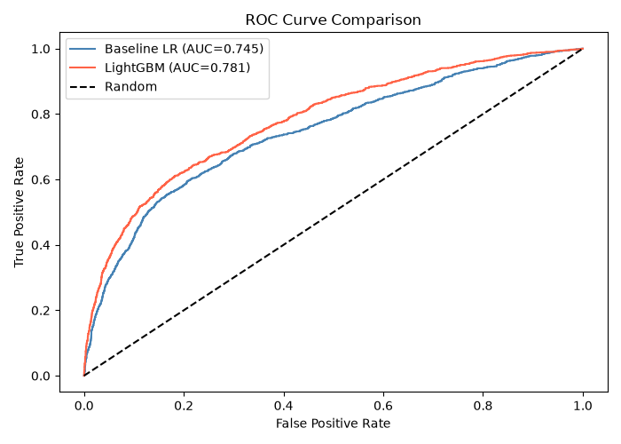
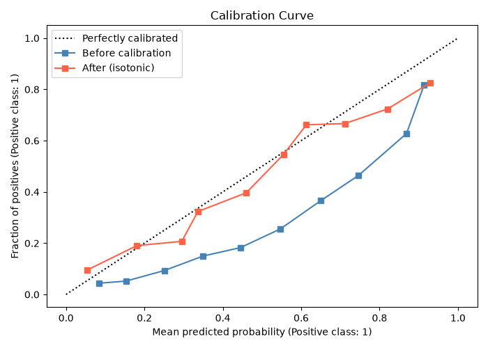
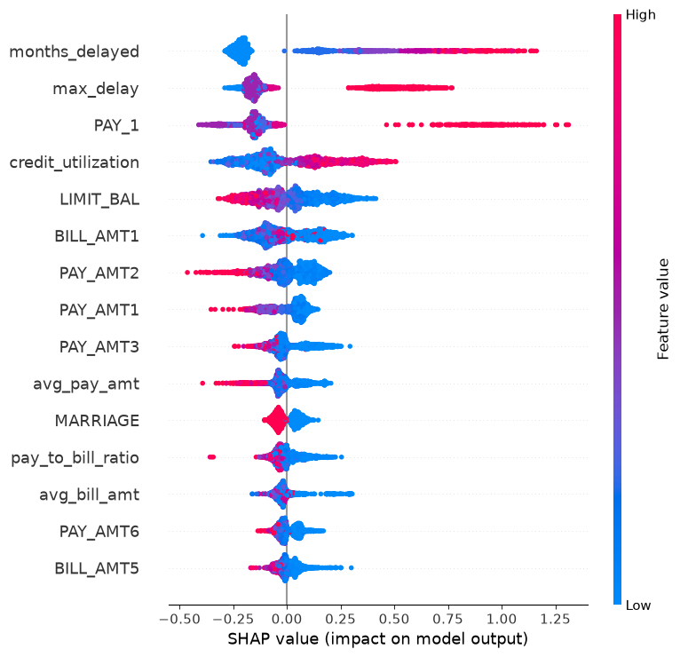
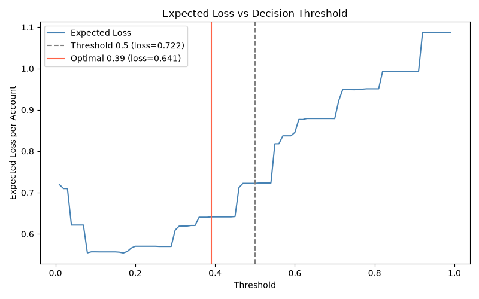

# Default of Credit Card Clients — ML Prediction & Decision Pipeline

## Problem Statement

This project predicts whether a credit card client will default on their next month's payment using the UCI "Default of Credit Card Clients" dataset (30,000 clients in Taiwan, 2005). The goal is not merely to rank clients by risk, but to make an explicit approve/decline decision that minimises expected business cost under a stated cost assumption: approving a defaulter costs 5× more than declining a good customer. All headline numbers are produced by code in this repository and stored in `reports/metrics.json`; no metric is hardcoded or invented.

<!-- RESULTS:START -->
<!-- RESULTS:END -->

## Figures






## How to Run

```bash
# 1. Create virtual environment and install dependencies
python -m venv .venv
.venv\Scripts\activate        # Windows
# source .venv/bin/activate   # Linux / macOS
pip install -r requirements.txt

# 2. Run the full pipeline (data → models → calibration → SHAP → threshold → report)
python -m src.run_all

# 3. Run tests
pytest tests/ -v
```

## Methodology

1. **Data** — UCI dataset (id 350, via `ucimlrepo`; falls back to OpenML). Cleaned to remap erroneous `EDUCATION` (0/5/6 → 4) and `MARRIAGE` (0 → 3) codes; `PAY_0` renamed to `PAY_1`; `ID` dropped; no missing values remain.
2. **Split** — Stratified 80/20 train/test split (`SEED=42`) performed *before* any fitting step.
3. **Feature Engineering** — 6 features added without fitting: `avg_bill_amt`, `avg_pay_amt`, `pay_to_bill_ratio` (guarded divide-by-zero), `months_delayed` (PAY_x > 0), `credit_utilization`, `max_delay`.
4. **Baseline** — `StandardScaler` + `LogisticRegression(class_weight='balanced')` pipeline.
5. **LightGBM** — ~300 trees; 20-trial randomised hyperparameter search scored by ROC-AUC on 5-fold stratified CV on training data only.
6. **Calibration** — `CalibratedClassifierCV` (isotonic or sigmoid) selected by validation Brier score on a held-out slice of *training* data. Test set never used for method selection.
7. **SHAP** — `TreeExplainer` on a 2,000-row test-set sample; summary plot and top-5 features stored.
8. **Threshold** — Out-of-fold predictions on training data used to pick the cost-minimising threshold; that fixed threshold is then evaluated on the test set only.

## Cost Assumption

> **The 5:1 cost ratio (`COST_FN=5`, `COST_FP=1`) is an ASSUMPTION**, not an empirically derived value. The sensitivity table in `reports/sensitivity.csv` shows how the optimal threshold and loss reduction change as this ratio varies across 2:1, 3:1, 5:1, and 10:1.

## Limitations

- **Taiwan 2005 data** — Results may not generalise to other markets or time periods.
- **No time-based split** — The train/test split is random; row timestamps are unavailable for a proper temporal split.
- **~22% default rate** — Moderate class imbalance, addressed with `class_weight='balanced'` in all models.
- **Assumed costs** — The 5:1 FN/FP ratio is illustrative; real costs depend on loan amounts and business policy.
- **No fairness audit** — Disparate impact across demographic groups (SEX, AGE, EDUCATION) has not been audited.
- **Single bank** — Data from one Taiwanese bank; broader samples might yield different conclusions.

## Project Structure

```
├── .gitignore
├── requirements.txt
├── README.md
├── data/
│   ├── raw/            ← gitignored; downloaded on first run
│   └── processed/
│       └── test_preds.csv
├── notebooks/
│   └── 01_eda.ipynb
├── reports/
│   ├── metrics.json
│   ├── sensitivity.csv
│   └── figures/
│       ├── default_by_education.png
│       ├── default_by_pay1.png
│       ├── correlation_heatmap.png
│       ├── roc.png
│       ├── calibration.png
│       ├── shap_summary.png
│       └── threshold.png
├── src/
│   ├── __init__.py
│   ├── config.py
│   ├── data.py
│   ├── features.py
│   ├── models.py
│   ├── evaluate.py
│   ├── explain.py
│   ├── threshold.py
│   ├── report.py
│   ├── run_baseline.py
│   ├── run_lgbm.py
│   ├── run_shap.py
│   ├── run_threshold.py
│   └── run_all.py
└── tests/
    ├── __init__.py
    ├── test_metrics.py
    └── test_threshold.py
```
